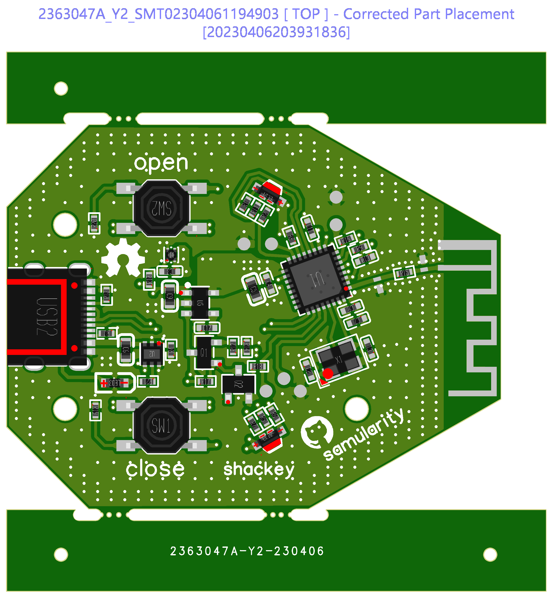
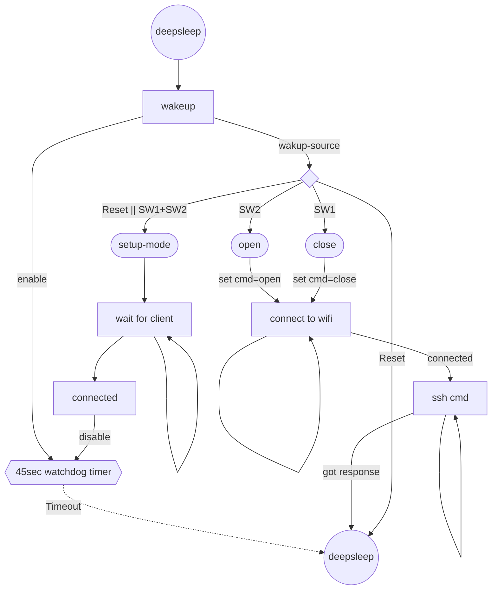

# shackey

[](https://github.com/samularity/shackey/actions/workflows/build.yml)
[](https://github.com/samularity/shackey/actions/workflows/cppcheck.yml)
[](https://samularity.github.io/shackey/)
[](https://samularity.github.io/shackey/shackey.bin)

A simple ESP32-C3 SSH client on a keychain device.
Its main (and only) goal is to open or close the [shackspace portal](https://github.com/shackspace/portal300) with a button press.



> [!WARNING]
> **Hardware issues**
> - LED2 green is on in deepsleep. FIX: remove R7
> - U4 XB6042J2SV-L is not working as expected. FIX: bridge B_GND and GND,
>   this disables the undervoltage protection!


## Quick start

1. **flash** the latest firmware with the [web flasher](https://samularity.github.io/shackey/) (Chrome / Edge),
   short the boot pin while connecting USB. Flashing keeps your uploaded keys.
2. **setup-mode**: press reset (or hold both buttons while waking up), LED1 turns blue
3. connect to the open wifi `shackey`, the captive portal opens (or go to http://192.168.4.1)
4. **upload** your private and public key with the names `key` and `key.pub`
   (RSA, without passphrase)
5. your public key must be authorized on `portal.shackspace.de`
   for the users `open-front` and `close`, see [portal300](https://github.com/shackspace/portal300)


## Usage

| action | result |
|---|---|
| SW2 `open` | open the portal, LED1 green |
| SW1 `close` | close the portal, LED1 red |
| both buttons while running | abort, back to deepsleep |
| reset | setup-mode, LED1 blue |

- after a button press it connects to the wifi `Portal-Dev` and sends the ssh command
- it goes back to deepsleep when done, or after 45 sec at the latest
- in setup-mode it stays awake as long as a client is connected


## How it works

- deepsleep
- wake up by one of the two buttons (or reset)
- connect to wifi
- open a SSH session with your private key on the portal server
- in setup-mode provide a webserver to upload or delete your key

<details>
<summary>flowchart</summary>



</details>


## Hardware

- schematic: [png](hardware/schematic_shackey_final_1mmslot_2023-04-06.png)
- pcb: [png](hardware/pcb_shackey_final_1mmslot_2023-04-06.png), [outline (dxf)](hardware/outline_shackey_final_1mmslot_2023-04-06.dxf)

<details>
<summary>ESP32-C3 pinout</summary>

| PIN-Number | ESP-Pin Name | Description  |
|----|----------------------|--------------|
|  6 | GPIO2                | 10k Pullup   |
| 14 | GPIO8                | 10k Pullup   |
| 15 | GPIO9                | BOOT         |
|  4 | GPIO0 / XTAL_32K_P   | Enable ADC   |
| 27 | GPIO20 / U0RXD       | ADC          |
|  9 | GPIO4 / MTMS         | SW1 Close (High when pressed) |
| 10 | GPIO5 / MTDI         | SW2 Open (High when pressed) |
| 16 | GPIO10               | LED1 Green   |
| 12 | GPIO6 / MTCK         | LED1 Red     |
| 13 | GPIO7 / MTDO         | LED1 Blue    |
| 18 | GPIO11 / VDD_SPI     | LED2 Green (not usable as GPIO, reserved for VDD_SPI) |
|  8 | GPIO3                | LED2 Red     |
|  5 | GPIO1 / XTAL_32K_N   | LED2 Blue    |
| 28 | GPIO21 / U0TXD       | TX-Testpin   |
|  7 | Chip_EN              | Reset        |

</details>


## Development

### Software components
- [libssh2](https://github.com/libssh2/libssh2) master as git submodule, updated automatically by CI if it still builds
- based on espidf 5.5 with [PlatformIO](https://platformio.org/), 6.x needs mbedTLS 4 support in libssh2 ([#2284](https://github.com/libssh2/libssh2/pull/2284))
- arduino free without any outdated dependencies or additional overhead

### Build

```sh
git clone --recursive https://github.com/samularity/shackey.git
cd shackey
pip install platformio      # python 3.12, see NixOS below
pio run
```

Flash via USB, short the boot pin first:

```sh
pio pkg exec -p tool-esptoolpy -- esptool.py --chip esp32c3 --port /dev/ttyACM0 \
  write_flash 0x0 .pio/build/esp32-c3-devkitm-1/bootloader.bin \
  0x8000 .pio/build/esp32-c3-devkitm-1/partitions.bin \
  0x10000 .pio/build/esp32-c3-devkitm-1/firmware.bin
```

Update libssh2 to the latest master: `git submodule update --remote`

<details>
<summary>Build on NixOS</summary>

The toolchains from platformio are prebuilt binaries, so [nix-ld](https://github.com/nix-community/nix-ld) is needed.
In your `configuration.nix`:

```nix
programs.nix-ld.enable = true;
users.users.<you>.extraGroups = [ "dialout" ]; # access to /dev/ttyACM0
```

Setup once (espidf python deps have no wheels for the newest python, so use 3.12 from `shell.nix`):

```sh
nix-shell
python3.12 -m venv ~/.platformio/penv
~/.platformio/penv/bin/pip install platformio
```

Then use `~/.platformio/penv/bin/pio` for the commands above.
The venv links into the nix store, after `nix-collect-garbage` it may be broken, just repeat the setup.

</details>

### CI
- **build**: on every push, on `main` the firmware and the [web flasher](https://samularity.github.io/shackey/) are published on GitHub Pages
- **libssh2 update**: tuesday and friday, updates libssh2 to the latest master and commits it if it still builds
- **cppcheck**: static code analysis of `src/` and `include/`, false positives are listed in `.cppcheck-suppressions`


## thx & refs

- [libssh2](https://github.com/libssh2/libssh2)
- [libssh2 #2284: mbedTLS 4 / PSA support](https://github.com/libssh2/libssh2/pull/2284) (wip: needed for espidf 6.x)
- [esp-idf examples](https://github.com/espressif/esp-idf/tree/master/examples/)
- [ewan.cc libssh2 on ESP32](https://www.ewan.cc/?q=node/157)
- [LibSSH-ESP32](https://github.com/ewpa/LibSSH-ESP32)
- [esp-idf-ssh-client](https://github.com/nopnop2002/esp-idf-ssh-client)
- [ESP Web Tools](https://github.com/esphome/esp-web-tools)
- [coplanar waveguide calculator](https://wcalc.sourceforge.net/cgi-bin/coplanar.cgi?wc_unit_menu_1_0=nH&wc_unit_menu_1_1=inch&wc_unit_menu_2_0=mOhm&wc_unit_menu_2_1=inch&wc_unit_menu_3_0=pF&wc_unit_menu_3_1=inch&wc_unit_menu_4_0=uMho&wc_unit_menu_4_1=inch&wc_unit_menu_7_0=dB&wc_unit_menu_8_0=dB&wc_unit_menu_8_1=inch&wc_unit_menu_12_0=mil&wc_unit_menu_11_0=ns&wc_unit_menu_13_0=inch&w=0.360&wc_unit_menu_0_0=mm&s=0.254&l=4.97148&wc_unit_menu_5_0=mm&tmet=0.0348&rho=3e-08&wc_unit_menu_9_0=Ohm&wc_unit_menu_9_1=m&rough=0.001&wc_unit_menu_10_0=mil&h=0.2104&es=4.8&tand=0.01&freq=2400&wc_unit_menu_6_0=MHz&analyze=Analyze&withgnd=on&Ro=50.3278&elen=26.6633) (antenna feed line)
